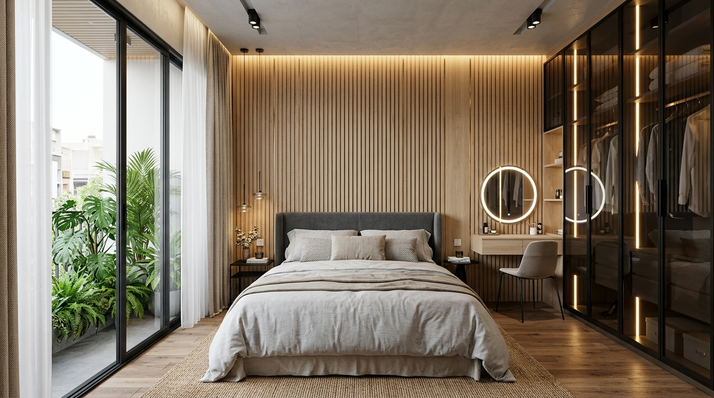
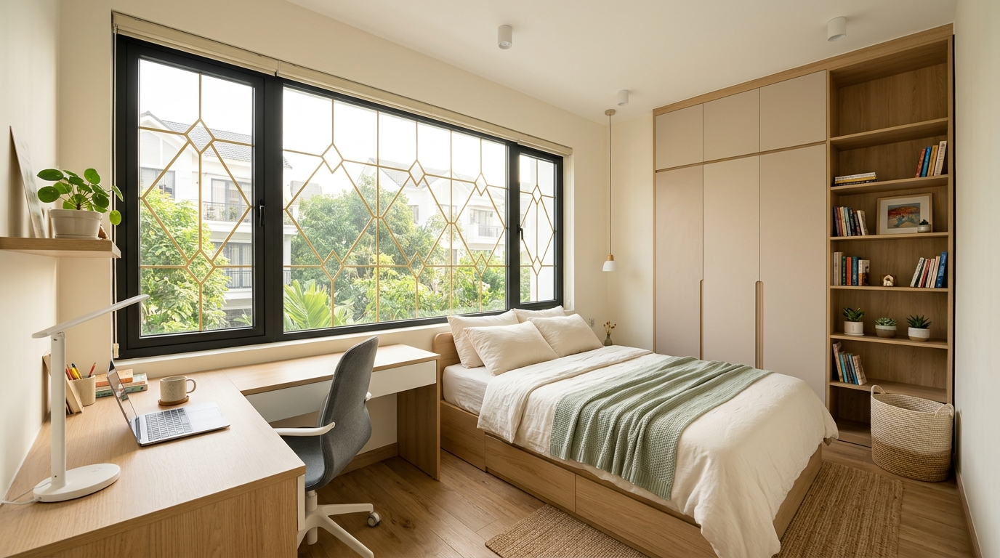
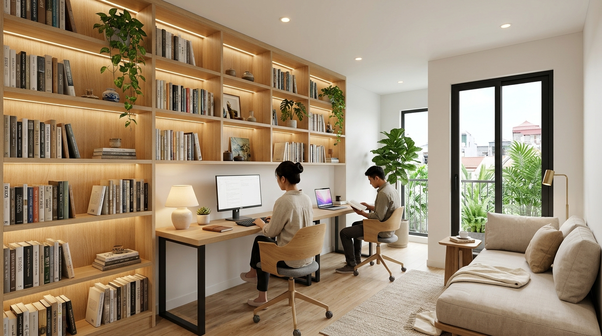
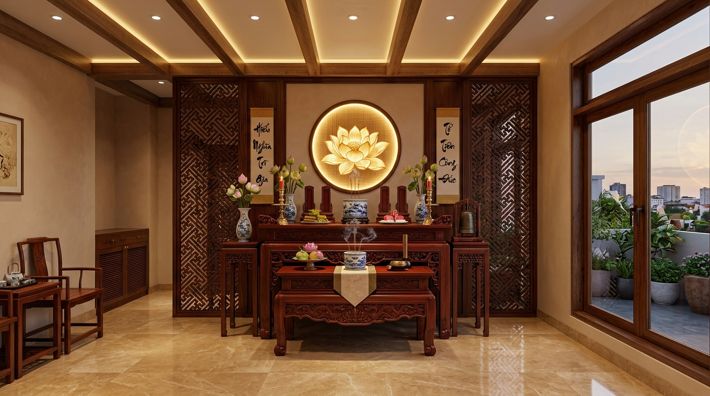
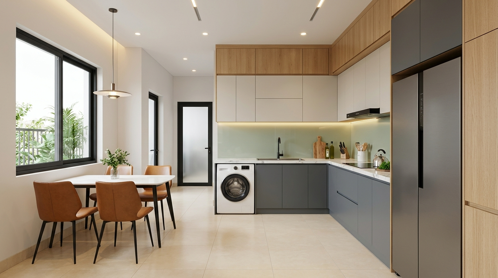

# Mo Hinh 3D Kien Truc Nha Pho 3 Tang + Tum San Thuong (39.4m2)

Ung dung hien thi mo hinh 3D tuong tac kien truc va noi that thuc te cong trinh nha pho tai Phuong Binh Phu, Quan 6, TP.HCM (Thua 22, To 31, hem 4m thong ra Hau Giang).

## Trai Nghiem Truc Tuyen (GitHub Pages)
Sau khi kich hoat GitHub Pages, truy cap truc tiep tai:
- **Mo Hinh 3D Tuong Tac**: https://vuongpq92.github.io/xay-nha/
- **Ban Ve Ket Cau & Kich Thuoc CAD 2D**: https://vuongpq92.github.io/xay-nha/ketcau.html

---

## Thong So Kien Truc Ky Thuat

- **Dien tich dat quy hoach**: 39.4 m2 (mat tien vat goc xeo ranh lo gioi 2.92m).
- **Quy mo cong trinh**: 1 Tret, 2 Lau, 1 Tum san thuong (Tong chieu cao ~15.5m).
- **Chieu cao cac tang chuan**:
  - **Tang Tret**: 4.0m (Cot 0.00m -> +4.00m).
  - **Lau 1**: 4.0m (Cot +4.00m -> +8.00m).
  - **Lau 2**: 4.0m (Cot +8.00m -> +12.00m).
  - **Tum & San Thuong**: 3.5m (Cot +12.00m -> +15.50m).
- **Cua chinh tang tret**: Nhom kinh Xingfa 4 canh mau xam den, kich thuoc lot long **Ngang 2.15m x Cao 2.36m** (chuan Lo Ban), **toan bo tuong mat tien tret, tru cot va vach kẹp cua deu son trang dong bo 100%** voi cac tang lau phia tren, bac them op da hoa cuong den kim sa.
- **Phong khach tang tret (Quy hoach Vi tri 1)**: Xoa bo hoan toan bo sofa va ban tra cu o vi tri so 2 giua nha. Bo tri **bo sofa vang 3 cho ni cao cap (2.20m x 0.85m x 0.75m) ap sat tuong ben phai** (tuong Truc B) tua lung vung chai chuan phong thuy, kem ban tra mat da marble trang van may chan thep den (1.00m x 0.46m) va tham trai san ni det. Doi dien la ke Tivi go dai 2.0m va Smart TV 65 inch ap tuong trai (Truc A) voi cu ly xem chuan 2.65m. Thiet ke giai phong hoan toan truc giao thong trung tam **rong > 1.6m**, tao khoang dem sanh truoc nha de duoc 3-4 xe may thoai mai ma khong can tro loi di.
- **Truc cau thang chu U lien hoan xuyen suot (Dong bo 100% Tret, Lau 1, Lau 2)**: He thong cau thang chu U 2 ve dao chieu 180 do, ban thang rong **0.80m**, gom **21 bac cung Sinh moi tang** (co bac trang su, mat bac da granite kim sa den), chieu nghi tai cao do giua tang (+2.0m, +6.0m, +10.0m), hanh lang ben hong rong **0.86m**. **He tay vin go cam xe tu nhien doc chuan xac 100% theo chieu bac thang**, xuat phat tu **Tru De-ba vuong 110x110mm** uy nghi tai bac 1 cua moi tang, con tien sat hoa oval nghe thuat tiep xuc khit khao duoi day tay vin, he tru goc chieu nghi va tru don san lien mach. Ban san cac tang khoet lo gieng thang tao truc thong tang lay sang tu nhien, kem lan can an toan bao ve mep san chieu nghi va san Tum.
- **Phong ngu tang tret mo rong vao gam cau thang Ve 2**: Khong gian duoi gam Ve 2 cau thang va gam chieu nghi (cao do 2.0m -> 4.0m) duoc **sap nhap 100% vao phong ngu** (dien tich tang tu 7.5m2 len ~9.8m2). Bo tri **tu quan ao 2 canh lua hien dai (1.6m x 2.1m) am khit khao duoi gam Ve 2** va ban phan/ban lam viec duoi gam chieu nghi, giai phong toan bo long phong cho giuong ngu doi 1.6m x 2.0m va 2 tab dau giuong thong thoang vuot troi.
- **Nha ve sinh tang tret**: Kich thuoc lot long tieu chuan vang **Chieu tu tuong ben ra 2.00m x Chieu doc theo nha 1.20m** (dien tich 2.4m2). Thiet ke toi uu luu thong trung tam: Ban cau lien khoi su trang duoc xoay 90 do ep sat vach tuong hong phai (mep trong) giai phong 100% long san trung tam, tren vach hong trang bi voi xit ve sinh bidet spray va voi nuoc phu/xả san Inox 304 tien loi; Goc trong phia sau la Cabin tam dung doc lap co vach kinh cuong luc 10mm kem go da chan nuoc 50mm chong tran, bo sen cay massage Inox 304 va pheu thu san dai thoat nhanh; Goc ngoai doi dien cua la ban da Lavabo marble (0.55m x 0.40m) kem guong soi bo goc vien LED. Cua Xingfa 0.70m x 2.20m mo tu hanh lang rong 1.33m. Phong ngu tang tret dai **4.065m** (>10.5m2) rong rai, sang trong.
- **Cua hau ra sau tang tret**: Bo cua di nhom **Xingfa he 55 "co xuong" chiu luc & chong trom** (kich thuoc lot long **Ngang 1.08m x Cao 2.15m**), he khung nhom mau xam den sang trong, do bung ngang tay gat 85mm, 3 thanh do xuong ngang phu chia 5 o kinh cuong luc an toan, tich hop nan hoa dong qua tram 3D (Diamond Medallions) sang trong dong bo voi he cua so toan nha, khoa tay gat da diem inox cao cap.
- **He cua so dong nhat Lau 1 & Lau 2 (Mat tien vat & Tuong hong phong sau)**: Tat ca 4 cua so deu dong nhat kich thuoc **Ngang 1.08m x Cao 1.26m** (bau cua cao 0.90m, da lanh-to cao 1.84m). Thiet ke chuan theo anh mau thuc te: O fix kinh suot lay sang phia tren cao 0.34m, phia duoi la 2 canh mo nhom Xingfa xam den lap nan hoa dong mang hoa van qua tram noi 3D (Diamond Medallions) sang trong.
- **Lau 1: Tuong ngan cau thang, Khong gian Bep & Ban an gia dinh hien dai, Toilet dong bo tang tret**:
  - **Tuong ngan sau cau thang**: Xay tai truc $Z = -0.82\text{ m}$ (ngay sau ve 2 va chieu nghi cau thang Lau 1), day $150\text{ mm}$, cao kich tran $4.00\text{ m}$, tro cua di $0.90\text{ m} \times 2.20\text{ m}$ lech sang hanh lang trai giup cach ly triet de mui nau nuong khoi am len lau 2 hoac bay vao phong ngu master.
  - **Khong gian Bep & Ban an (3.25m x 3.45m, S ~ 11.2m2)**: He tu bep chu L mat da Marble sang trong (bep tu am doi, chau rua bat Inox 304 2 ho, tu bep tren kich tran, may hut mui kinh cong, tu lanh Side-by-side 2 canh lon). Bo ban an 4-6 ghe boc da am cung dat trung tam don anh sang tu nhien tu cua so hong trai 1.08m x 1.26m.
  - **Toilet Lau 1 (2.00m x 1.20m, S = 2.4m2)**: Dong bo 100% thiet bi voi tang tret va dong truc dung hoan hao voi hop gen MEP (ban cau xoay 90 do ep vach hong phai, voi xit bidet & voi xa san phu, cabin tam dung vach kinh 10mm + go da chan nuoc 50mm, sen cay massage Inox 304, ban da Lavabo guong LED).
- **Ban cong thut vao (Loggia) & Cua di Xingfa 2 canh Lau 1 & Lau 2**: Mang tuong thang mat tien thut vao 1.0m tao ban cong rong 1.52m x sau 1.0m co lan can kinh 1.1m, lap **bo cua di 2 canh nhom kinh Xingfa co o fix tren kich thuoc Ngang 1.20m x Cao 2.36m** (chuan theo anh mau thuc te), canh mo quay ra ban công, den LED tran chieu sang am cúng loai bo hoan toan khoang toi.
- **Tum & San Thuong (Cot +12.0m -> +15.5m)**: Khoi Tum (phong tho, tum thang, giat phoi) duoc **doi sat 100% ve vach sau nha** (dai 4.5m tu Z = -5.265m den -0.765m), mai tum dat bon nuoc inox va may NLMT. Mat truoc tum co **Cua di nhom kinh Xingfa duoc doi lech sang ben trai (thang truc hanh lang tu cau thang len)**, danh mang tuong dac ben phai rong 2.3m cho phong tho trang nghiem khong bi gio lua truc dien. Cua mo ra **San thuong phia truoc sieu rong rai (~6.0m chieu dai, dien tich >20m2)** voi **Gian lam Pergola 4 cot thep hop vuong van (3.1m x 2.3m)** nam gon 100% trong ranh nha khong bi loi ra ngoai, bo ban ghe cafe chill duoi bong mat va tiec BBQ ngoai troi, bon cay canh uon gon theo lan can goc vat.

---

## Cong Nghe Phat Trien
- **Three.js (r128)**: Render 3D WebGL truc tiep tren trinh duyet khong can cai dat plugin.
- **OrbitControls**: Dieu khien xoay 360 do, pan, zoom muot ma tren ca PC va cam ung cham dien thoai.
- **Tween.js**: Chuyen canh camera goc nhin thong minh.
- **Mobile Responsive UI/UX**:
  - **Zen Mode (`👁️`)**: Nut an/hien 100% giao dien de chiem nguong mo hinh 3D toan man hinh khong bi che khuat.
  - **Header thu gon thong minh**: O che do di dong (<768px), header tu dong thu nho thanh badge vien bo tron chi chiem <6% chieu cao man hinh, bam de bung xem day du thong tin.
  - **Thanh camera cuon ngang**: Cho phep nguoi dung dien thoai vuot ngang chuyen nhanh 10 goc camera dac sac (Tum, Ban cong Xingfa, Cua so vat, Cau thang U...).
  - **Auto Camera FOV**: Tu dong can chinh goc nhin rong (FOV 54) khi cam doc dien thoai de bao quat toan bo 15.5m chieu cao toa nha.

---

## Cập Nhật Thiết Kế Nội Thất Chi Tiết Toàn Nhà (4 Tầng)

Toàn bộ nội thất trên mô hình 3D [`index.html`](index.html) đã được nâng cấp đồng bộ theo phong cách **Hiện Đại Tối Giản Ấm Áp (Modern Minimalist Warmth)**:

### 1. Tầng Trệt (`gFurn`)
- **Sảnh vào & Tủ giày thông minh**: Bố trí sát tường phải gần cửa chính 4 cánh góc xéo gồm tủ giày kịch trần + ghế ngồi thay giày + hắt LED gầm.
- **Khu vực Phòng Khách**: Nâng cấp vách Tivi ốp đá Marble kết hợp lam sóng gỗ hai bên và hắt đèn LED ấm, bổ sung tủ trưng bày/rượu cánh kính bên hông cầu thang; ốp lam sóng gỗ sồi + tranh trang trí sau lưng Sofa.

### 2. Lầu 1 (`f1Furn`)
- **Phòng Ngủ Master**: Giường King 1.8m x 2.0m tựa vách lam sóng gỗ sồi nẹp chỉ đồng & LED hắt ấm, 2 tab đầu giường, tủ quần áo cánh kính khói khung nhôm đen kịch trần kết hợp khoang Tivi âm, bàn trang điểm treo với gương Oval LED và rèm 2 lớp tại cửa ban công Loggia.
- **Toilet Lầu 1 & Lầu 2**: Chuẩn hóa qua helper dùng chung `createStandardFloorToilet` và `createStairRearPartition` đảm bảo đồng trục MEP tuyệt đối (ngang 2.0m x dọc 1.2m).

### 3. Lầu 2 (`f2Furn`)
- **Phòng Ngủ 3 (Phía trước)**: Giường đôi 1.6m x 2.0m có 2 ngăn kéo dưới gầm, bàn học chữ L đón sáng cửa sổ vát + ghế công thái học, tủ áo 3 cánh gỗ sồi phối trắng.
- **Phòng Làm Việc & Thư Viện Sách (Khoang sau)**: Vách ngăn sau cầu thang đồng bộ Lầu 1; bàn làm việc đôi 1.65m x 0.65m với 2 màn hình & 2 ghế công thái học; hệ tủ sách kịch trần hắt LED ấm áp sát tường phải và góc daybed đọc sách bên cửa sổ hông; bổ sung **Toilet Lầu 2** đồng trục.

### 4. Tầng Tum & Sân Thượng (`roofFloor`)
- **Phòng Thờ Trang Nghiêm**: Bàn thờ gỗ gụ/hương 3 cấp (1.27m x 0.61m) áp vách đặc bên phải, đĩa tròn Trúc Chỉ hoa sen phát sáng vàng ấm, vách CNC ngăn tách khu giặt sấy (máy giặt/máy sấy xếp chồng + tủ hóa chất + sào phơi).
- **Sân Thượng & Pergola**: Bổ sung mái kính cường lực màu trà chống UV trên hệ nan lam và dây đèn Edison ngoài trời.

### 5. Góc Nhìn Camera Mới Trên Mô Hình 3D
Đã bổ sung 4 góc nhìn trực tiếp vào nội thất từng phòng trên Desktop & Mobile: `master` (Master Lầu 1), `bedroom3` (Phòng Ngủ 3), `office` (Làm Việc Lầu 2), và `altar` (Phòng Thờ Tum).

| Phòng Ngủ Master Lầu 1 | Phòng Ngủ 3 Lầu 2 | Phòng Làm Việc Lầu 2 | Phòng Thờ Tum |
| :---: | :---: | :---: | :---: |
|  |  |  |  |

### Cập Nhật Khoang Bếp Lầu 1 (`kitchenGroup` — Chữ L Tách Khu Khô & Khu Ướt)
- **Khu Khô & Nấu Nướng (Tường Phải `X = +1.525m`):** Khoang Tủ lạnh Side-by-Side kịch trần (`0.70m x 0.82m x 1.85m`) tại góc Đông-Bắc (`X = +1.15m, Z = -1.34m`, cánh mở hướng `-X`), liền kề mặt đá bàn soạn + bếp từ âm đôi & máy hút mùi (`Z = -2.42m`).
- **Khu Ướt Quay Lưng Vào Toilet (`Z = -3.68m`):** Bồn rửa chén Inox 304 + vòi cổ ngỗng (`X = +0.61m`) quay lưng thẳng vào vách Toilet `Z = -3.99m`, cạnh bên trái là **Máy giặt lồng ngang âm bàn đá** (`X = +0.025m`), gom chung đường cấp thoát nước xuyên vách vào hộp gen WC Lầu 1.
- **Khu Bàn Ăn (`X = -1.08m, Z = -2.65m`):** Dời bộ bàn ăn 4 ghế về dưới cửa sổ hông trái (`1.08m x 1.26m`), mở thông hành lang trung tâm rộng `> 1.05m` và chuẩn hóa toàn bộ cốt đặt lên mặt sàn `4.25m`.

